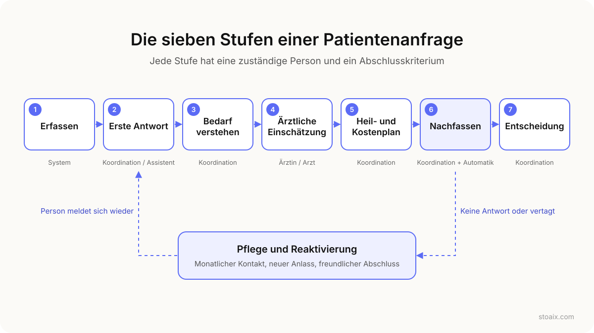

> **Kurze Antwort:** Management von Patientenanfragen bedeutet, dass jede Person, die Ihre Praxis kontaktiert, in einem schriftlich festgelegten und gemessenen Ablauf von der ersten Nachricht bis zum Beratungstermin (oder einem klaren Nein) begleitet wird, und zwar von einer namentlich zuständigen Person. Der Ablauf hat sieben Stufen: Erfassen, erste Antwort, Bedarf verstehen, ärztliche Einschätzung, Heil- und Kostenplan, Nachfassen und Entscheidung. Die meisten Anfragen gehen nicht an zu teuren Anzeigen verloren, sondern in den Lücken zwischen diesen Stufen.

## Was ist Management von Patientenanfragen?

Management von Patientenanfragen ist die Art, wie eine Praxis oder Privatklinik Menschen begleitet, die sich nach einer Behandlung erkundigen, vom ersten Kontakt bis zu ihrer Entscheidung. Eine Anfrage ist jede Person, die per WhatsApp, Instagram, Kontaktformular oder Telefon Kontakt aufgenommen, aber noch keinen Termin vereinbart hat. „Management“ heißt hier drei konkrete Dinge: Jede Anfrage hat eine zuständige Person, jede Stufe hat ein schriftliches Abschlusskriterium, und die Zeit zwischen den Stufen wird gemessen. Fehlen diese drei Punkte, „schaut die Praxis nach den Nachrichten“, sie managt aber keine Anfragen. Der Unterschied zeigt sich im Alltag. Ohne Ablauf hängt es davon ab, wie voll der Empfang gerade ist, ob eine Anfrage schnell beantwortet wird oder gar nicht. Mit Ablauf erhält dieselbe Anfrage unabhängig von der Besetzung in derselben Zeit eine Antwort in derselben Qualität, wird an festen Tagen erneut kontaktiert, wenn sie verstummt, und endet entweder als Termin oder als Verlust mit dokumentiertem Grund.

Der Leitfaden richtet sich an Zahnarztpraxen, ästhetische und plastische Praxen, Haartransplantations- und Augenkliniken sowie vergleichbare Selbstzahlerleistungen in Deutschland. Er beschreibt Kommunikation und Organisation, keine medizinischen Inhalte.

## Wo gehen Patientenanfragen verloren?

Praxen erklären verlorene Anfragen gern mit teuren Anzeigen oder „Preisvergleichern“. Wer den Ablauf genau ansieht, findet die Verluste meist an fünf Stellen:

1. **Späte erste Antwort.** Interessierte schreiben oft mehrere Praxen gleichzeitig an. In einer der meistzitierten Untersuchungen zum Thema, [veröffentlicht in der Harvard Business Review](https://hbr.org/2011/03/the-short-life-of-online-sales-leads), antworteten nur 37 % der untersuchten Unternehmen innerhalb einer Stunde auf eine Webanfrage, 23 % antworteten gar nicht. Das sind allgemeine Vertriebsdaten aus den USA, keine Praxisdaten; der Mechanismus ist aber derselbe: Interesse, das nicht im richtigen Moment aufgegriffen wird, kühlt ab.
2. **Keine Zuständigkeit.** Alle sehen die Nachricht, niemand übernimmt sie. Der Empfang denkt, die Ärztin meldet sich, die Ärztin denkt, der Empfang kümmert sich, und die Patientin wartet dazwischen.
3. **Stocken bei der Preisfrage.** Die erste Nachricht lautet oft „Was kostet das?“. Entweder kommt eine nackte Zahl und das Gespräch endet, oder die Antwort lautet „Kommen Sie zur Beratung“ und die Frage bleibt offen. Beides schickt die Person zurück in den Vergleich.
4. **Nachfassen ohne Mehrwert.** „Wollte nur kurz nachhören, ob Sie schon entschieden haben“ gibt der Person nichts, sondern verlangt etwas von ihr. Nach ein, zwei Versuchen wird nicht mehr nachgefasst.
5. **Keine Dokumentation.** Wer was gesagt hat, was die eigentliche Sorge war, wann zurückgerufen werden sollte: Das steht im Chatverlauf eines Diensthandys. Wechselt eine Mitarbeiterin oder war die Woche voll, ist der Zusammenhang verloren.

Keine dieser fünf Lücken schließt ein höheres Werbebudget. Mehr Anzeigen schicken nur mehr Anfragen durch dieselben Löcher.

## Der Ablauf in sieben Stufen

Ziel ist nicht, jede Anfrage möglichst schnell zum Termin zu drängen. Ziel ist, dass jede Anfrage den nächsten passenden Schritt geht oder den Ablauf mit einer klaren Entscheidung verlässt. Die Tabelle ist eine Vorlage für den Start; passen Sie die Zeiten an Ihre Kapazität an, halten Sie sie aber schriftlich fest.

| Stufe | Was passiert | Abschlusskriterium | Zuständig | Startwert für Ihren eigenen Standard |
|---|---|---|---|---|
| 1. Erfassen | Nachricht, Anruf oder Formular landet in einer gemeinsamen Liste | Datensatz angelegt, Quelle notiert | System | Sofort, ohne Abtippen |
| 2. Erste Antwort | Persönliche Ansprache mit Namen, Absender genannt | Erste Frage beantwortet | Patientenkoordination oder KI-Assistent | Minuten während der Sprechzeiten, außerhalb am nächsten Morgen zuerst |
| 3. Bedarf verstehen | Ziel, Sorge und Zeitrahmen werden erfragt | Ziel in den Worten der Person notiert | Patientenkoordination | Am selben Tag |
| 4. Ärztliche Einschätzung | Fotos, Röntgenbild oder Beratung klären die Eignung | Einschätzung der Ärztin oder des Arztes dokumentiert | Ärztin / Arzt | Zur zugesagten Zeit |
| 5. Heil- und Kostenplan | Optionen und Kosten werden schriftlich übermittelt | Plan erhalten und geöffnet | Patientenkoordination | Am Tag nach der Einschätzung |
| 6. Nachfassen | Kontakte mit Mehrwert in der Entscheidungsphase | Entscheidung oder klar vereinbarte Pause | Koordination plus Automatisierung | Fester Kalender |
| 7. Entscheidung | Termin, Anzahlung oder Verlust mit Grund | Termin im Kalender oder Verlustgrund erfasst | Patientenkoordination | Jede offene Anfrage hat eine datierte Aufgabe |

Jede Stufe hat einen eigenen Teil in dieser Reihe:

- Warum die Reaktionszeit an erster Stelle steht und wie man sie misst: [Reaktionszeit bei Patientenanfragen](/blog/reaktionszeit-patientenanfragen).
- Wer den Ablauf verantwortet: [die Patientenkoordinatorin in der Praxis](/blog/patientenkoordinatorin-praxis).
- Wie die erste Antwort aufgebaut ist: [Vorlagen für die erste Antwort](/blog/erste-antwort-patientenanfrage-vorlagen).
- „Was kostet das?“: [die Preisfrage von Patienten beantworten](/blog/patienten-preisfrage-beantworten).
- Nach dem Versand des Plans: [Heil- und Kostenplan nachfassen](/blog/heil-und-kostenplan-nachfassen).
- „Ich muss noch überlegen“, „zu teuer“, „ich frage meinen Mann“: [Patienteneinwände beantworten](/blog/patienteneinwaende-beantworten).
- Anfragen, die verstummen: [nicht antwortende Patientenanfragen](/blog/nicht-antwortende-patientenanfragen).
- Die Messung von allem: [Kennzahlen für Patientenanfragen](/blog/kennzahlen-patientenanfragen).

## Stufe für Stufe: worauf es ankommt

### 1. Erfassen: eine Liste, ein Quellenfeld

Landen WhatsApp, Instagram, Telefon, Kontaktformular und Anzeigenformulare an verschiedenen Orten, ist die erste Aufgabe, sie in einer Liste zusammenzuführen. Ein Praxis-CRM leistet das, eine gemeinsame Tabelle ist das Minimum. Vier Felder sollten Pflicht sein: Name, Kanal, Quelle (welche Kampagne, welche Seite) und die erste Nachricht selbst. Bleibt das Quellenfeld leer, kann in drei Monaten niemand sagen, welche Anzeige wirklich Patientinnen und Patienten gebracht hat.

### 2. Erste Antwort: schnell und menschlich

Die erste Antwort hat zwei Aufgaben: zeigen, dass die Frage ernst genommen wird, und das Gespräch zu einem kleinen nächsten Schritt führen. Eine gute erste Antwort spricht die Person mit Namen an, sagt, wer schreibt, gibt eine kurze, aber echte Antwort und endet mit einer einfachen Frage. Eine Preisliste als PDF, eine lange Praxisvorstellung oder nur „Vereinbaren Sie einen Termin“ leisten das nicht.

### 3. Bedarf verstehen: in den Worten der Person

In der Nachricht steht „Implantat Kosten“, gemeint ist vielleicht: nicht mehr die Hand vor den Mund halten beim Lachen. Diesen Satz in den Worten der Person festzuhalten, macht jede spätere Nachricht persönlich. Drei Fragen reichen meist: Was hat Sie gerade jetzt dazu gebracht, sich zu informieren? Was beschäftigt Sie am meisten? Bis wann möchten Sie es angehen?

### 4. Ärztliche Einschätzung: die zugesagte Zeit

Diese Stufe verantwortet die Ärztin oder der Arzt, und die Entscheidung über die medizinische Eignung liegt allein bei ihnen. Die Koordination sammelt, was für die Einschätzung nötig ist, und nennt der Person einen klaren Zeitpunkt für die Rückmeldung. Wurde ein Zeitpunkt zugesagt, geht zu diesem Zeitpunkt eine Nachricht raus, notfalls nur ein Zwischenstand. Für die Person ist das eine Vorschau darauf, wie verlässlich die Praxis nach der Behandlung ist.

### 5. Heil- und Kostenplan: das Dokument, das ohne Sie spricht

Ein Heil- und Kostenplan wird meist am Küchentisch gelesen, neben dem Angebot einer anderen Praxis. Er sollte mit dem Ziel der Person beginnen, klar sagen, was enthalten ist und was nicht, und mit einem nächsten Schritt enden. Wenn die Kosten nicht vollständig von der Krankenversicherung übernommen werden und die Praxis das weiß, besteht nach [§ 630c BGB](https://www.gesetze-im-internet.de/bgb/__630c.html) ohnehin eine Pflicht, vor der Behandlung in Textform über die voraussichtlichen Kosten zu informieren. Positionen, die „möglicherweise nötig“ sind, werden nicht versteckt, sondern als Varianten aufgeführt.

### 6. Nachfassen: jedes Mal ein Mehrwert

Wer nicht antwortet, sagt selten Nein. Meist ist die Entscheidung noch offen oder das Thema im Alltag untergegangen. Eine Nachfassnachricht sollte etwas geben, statt etwas zu verlangen: die Antwort auf eine häufige Frage, eine klare Information zum Heilungsverlauf, eine kurze Zusammenfassung für den Partner. Sagt die Person, dass sie keine weiteren Nachrichten möchte, endet das Nachfassen und der Wunsch wird dokumentiert.

### 7. Entscheidung: jede offene Anfrage mit datierter Aufgabe

Die Grundregel ist einfach: Jede offene Anfrage hat eine Aufgabe mit einem Datum in der Zukunft. Eine Anfrage ohne Aufgabe ist eine Anfrage ohne Zuständigkeit. Auch ein Verlust ist eine Entscheidung, wird aber mit einem Grund erfasst, der auf den Worten der Person beruht, nicht mit einer Vermutung wie „Preis“.

## Nachfassen nach Gefühl oder geregelter Ablauf

| Bereich | Nach Gefühl | Geregelter Ablauf |
|---|---|---|
| Erste Antwort | Wer gerade Zeit hat, wann er Zeit hat | Schriftlicher Antwortstandard, eigener Plan für außerhalb der Sprechzeiten |
| Zuständigkeit | „Das Team“ | Eine namentlich zuständige Person je Anfrage |
| Preisfrage | Nackte Zahl oder Ausweichen | Ehrliche Spanne, wovon sie abhängt, eine Frage |
| Nachfassen | Ein, zwei „Wollte nur nachhören“ | Fester Kalender, jedes Mal neue Information |
| Dokumentation | Chatverlauf im Diensthandy | CRM-Notiz: Sorge, Entscheider, nächster Schritt |
| Verluste | Bleiben unbemerkt | Grund wird erfasst, monatlich ausgewertet |
| Messung | Bauchgefühl („guter Monat“) | Quoten je Stufe, wöchentliche Übersicht |

## Wer macht was: Team, Ärztin und Software

In einer kleinen Praxis läuft der Ablauf mit zwei Personen, in einer größeren mit einem eigenen Team. Entscheidend sind nicht die Köpfe, sondern die Rollen:

- **Patientenkoordination:** verantwortet die Anfrage. Versteht den Bedarf, verbindet Person und Ärztin, bespricht den Plan und fasst nach. Trifft keine medizinischen Entscheidungen.
- **Ärztin / Arzt:** klärt Eignung und Behandlungsoptionen auf Basis der gesammelten Informationen und dokumentiert die Einschätzung zur zugesagten Zeit.
- **KI-Assistent:** gibt nachts, am Wochenende oder in Stoßzeiten die erste Antwort, beantwortet Routinefragen, schreibt alles ins CRM und übergibt an die Koordination. Versendet Erinnerungen zum Nachfassen pünktlich.
- **CRM:** das gemeinsame Gedächtnis des Teams. Stufen, Notizen, Aufgaben und Verlustgründe liegen hier.

Information und Erinnerung gehören in die Automatisierung, Urteil und Empathie zu Menschen. Sobald die Person antwortet, stoppen automatische Abläufe, und ein Mensch übernimmt.

## Rechtlicher Rahmen in Deutschland

Die Betreuung von Anfragen ist ein Verkaufsgespräch, steht aber nicht außerhalb des Gesundheits- und Wettbewerbsrechts. Vier Punkte sind besonders wichtig:

- **Heilmittelwerbung.** Das [Heilmittelwerbegesetz](https://www.gesetze-im-internet.de/heilmwerbg/) begrenzt Werbung für medizinische Leistungen, unter anderem bei Erfolgsversprechen und bei Vorher-Nachher-Darstellungen operativer plastisch-chirurgischer Eingriffe. Das betrifft Website, Social Media und Anzeigen; auch in Nachrichten sollten keine Erfolgsversprechen stehen.
- **Unzumutbare Belästigung.** Werbliche Nachrichten per E-Mail oder Messenger brauchen nach [§ 7 UWG](https://www.gesetze-im-internet.de/uwg_2004/__7.html) grundsätzlich eine vorherige ausdrückliche Einwilligung. Die Antwort auf eine Frage der Person ist etwas anderes als ein Werbe-Newsletter; das Nachfassen sollte trotzdem im Rahmen dessen bleiben, was die Person erwartet.
- **Gesundheitsdaten.** Fotos, Röntgenbilder und Vorerkrankungen sind Gesundheitsdaten nach [Art. 9 DSGVO](https://dsgvo-gesetz.de/art-9-dsgvo/). Sie gehören in die Systeme der Praxis, nicht auf private Handys, und die Person sollte wissen, wer sie zu welchem Zweck sieht.
- **Kosteninformation.** Bei Leistungen, die die Versicherung nicht oder nur teilweise trägt, gilt die oben genannte Pflicht zur Kosteninformation in Textform.

Diese Hinweise sind keine Rechtsberatung; lassen Sie Ihre Vorlagen und Abläufe von Ihrer Beratung prüfen.

## Was nicht gemessen wird, wird nicht gesteuert: fünf Quoten

Suchen Sie keinen Branchendurchschnitt, sondern bilden Sie eine Ausgangsbasis aus Ihren eigenen letzten 90 Tagen. Fünf Quoten genügen:

| Kennzahl | Formel | Was sie zeigt |
|---|---|---|
| Erste Reaktionszeit (Median) | Zeit vom Eingang bis zur ersten Antwort durch Mensch oder Assistent | Verlieren Sie Anfragen schon an der Tür? |
| Gesprächsquote | Anfragen mit mindestens zwei Nachrichten in beide Richtungen / alle Anfragen | Startet Ihre erste Antwort ein Gespräch? |
| Einschätzungsquote | Personen mit Fotos oder Beratungstermin / Personen im Gespräch | Bauen Sie früh genug Vertrauen auf? |
| Plan-zu-Entscheidung | Termine oder Anzahlungen / Personen mit Heil- und Kostenplan | Wirken Plan und Nachfassen? |
| Dokumentierte Verlustgründe | Verluste mit Grund / alle Verluste | Können Sie aus Verlusten lernen? |

Nutzen Sie den Median, nicht den Durchschnitt: Drei Nachrichten, die über Nacht zehn Stunden warten, verzerren den Durchschnitt und verdecken das eigentliche Problem. Eine ausführliche Wochenübersicht finden Sie unter [Kennzahlen für Patientenanfragen](/blog/kennzahlen-patientenanfragen).

## 30-Tage-Plan für die Einführung

Bauen Sie den Ablauf nicht an einem Tag. Vier Wochen geben dem Team Zeit, sich umzustellen:

| Woche | Was zu tun ist | Was Sie am Ende der Woche haben |
|---|---|---|
| Woche 1: Sehen | Alle Kanäle in eine Liste führen. Anfragen der letzten 30 Tage nachtragen. Reaktionszeit messen. | Ihre echte Ausgangsbasis |
| Woche 2: Zuständigkeit | Jeder Anfrage eine zuständige Person geben. Stufen und Abschlusskriterien aufschreiben. Erste Antwort außerhalb der Sprechzeiten regeln. | Keine Anfrage ohne Zuständigkeit |
| Woche 3: Standardisieren | Vorlagen für erste Antwort, Preisfrage und drei Nachfassnachrichten gemeinsam mit dem Team schreiben. Rückmeldezeiten mit den Ärztinnen und Ärzten vereinbaren. | Gleiche Qualität, egal wer schreibt |
| Woche 4: Messen und verbessern | Erste Wochenübersicht erstellen. Die eine Stufe mit dem größten Verlust auswählen und nur sie verbessern. | Ein Schwerpunkt für den nächsten Monat |

Am Ende der vierten Woche ist es verlockend, alles auf einmal zu ändern. Tun Sie es nicht: ein Engpass, ein Schwerpunkt. Lassen Sie eine Änderung mindestens drei bis vier Wochen laufen, bevor Sie sie bewerten.

## Wo STOAIX ansetzt

STOAIX wurde gebaut, damit dieser Ablauf in der Praxis tatsächlich läuft. [Lead-Nachfassen](/de/lead-nachfassen) beantwortet neue Anfragen innerhalb von Sekunden mit den Informationen der Praxis, hält Frage und Sorge der Person fest und führt den Nachfasskalender selbstständig. Der [KI-Telefonassistent](/de/ki-telefonassistent) übernimmt die erste Antwort außerhalb der Sprechzeiten. Jedes Gespräch liegt im [Praxis-CRM](/de/praxis-crm) mit zuständiger Person und nächster Aufgabe. Für Anfragen, die lange still waren, greift die [Patientenreaktivierung](/de/patientenreaktivierung).

Genauso klar ist, was die Software nicht tut: Sie entscheidet nicht über die medizinische Eignung, spricht nicht anstelle der Ärztin und verschickt keine Drucknachrichten. Jede Methode in diesem Leitfaden lässt sich auch ohne Software umsetzen, mit einer Tabelle und einer disziplinierten Koordination; die Software hält diese Disziplin auch in vollen Wochen aufrecht.

## Häufige Fehler

- **Zuerst mehr Werbung schalten.** Ein undichter Eimer wird mit mehr Wasser nicht voller. Erst Reaktionszeit und Zuständigkeit klären.
- **Allen dieselbe Vorlage schicken.** Eine Vorlage ist ein Gerüst; Name, Frage und Kanal der Person gehören in jede Nachricht.
- **Nachfassen einer Person überlassen.** „Frau Weber fasst immer zuverlässig nach“ ist kein Ablauf. Ist Frau Weber im Urlaub, ist der Ablauf es auch.
- **Jeden Verlust als „Preis“ erfassen.** Meist ist das geraten. Notieren Sie, was die Person tatsächlich gesagt hat; oft geht es um Vertrauen oder den Zeitpunkt.
- **Tempo mit Druck verwechseln.** Seien Sie schnell, aber drängen Sie die Person nicht. Künstliche Fristen und „nur heute“-Angebote beschädigen das Vertrauen in eine medizinische Entscheidung und können wettbewerbsrechtlich problematisch sein.

## Häufige Fragen

### Was ist der Unterschied zwischen einer Anfrage und einem Patienten?

Eine Anfrage ist eine Person, die Kontakt aufgenommen, aber noch keinen Termin vereinbart oder keine Behandlung begonnen hat. Mit dem ersten Termin wird sie zur Patientin oder zum Patienten. Die Unterscheidung ist wichtig, weil das Ziel des Gesprächs mit einer Anfrage nicht die Behandlung ist, sondern eine informierte Entscheidung.

### Braucht eine Praxis eine eigene Patientenkoordinatorin?

Nicht unbedingt, aber eine eigene Rolle. In einer kleinen Praxis kann eine Mitarbeiterin am Empfang feste Zeitfenster nur für Anfragen reservieren. Wichtig ist, dass jede Anfrage eine namentlich zuständige Person hat und die Arbeit nicht im Telefonverkehr untergeht. Mit wachsendem Volumen wird die Rolle zu einer eigenen Stelle.

### Wie lange sollte man bei einer Patientenanfrage nachfassen?

In den ersten drei Tagen, solange das Gespräch warm ist, häufiger, in den folgenden zwei Wochen seltener, danach in einem monatlichen Rhythmus. Jeder Kontakt sollte etwas Neues bieten. Sagt die Person, dass sie keine weiteren Nachrichten möchte, wird sofort aufgehört und der Wunsch dokumentiert.

### Darf ein KI-Assistent mit Patientenanfragen sprechen?

Ja, mit klaren Grenzen. Die erste Antwort geben, von der Praxis freigegebene Informationen teilen, Terminoptionen anbieten und alles dokumentieren ist seine Aufgabe. Medizinische Einschätzung, individuelle Behandlungsempfehlungen und Preisverhandlungen bleiben beim Team und bei der Ärztin oder dem Arzt. Antwortet die Person, übernimmt die Koordination.

### Was ist der häufigste Fehler im Umgang mit Patientenanfragen?

Anfragen ohne Zuständigkeit. Alle sehen die Nachricht, niemand übernimmt; die erste Antwort kommt spät, nachgefasst wird nicht, und die Person geht still zur nächsten Praxis. Jeder Anfrage eine zuständige Person und eine datierte nächste Aufgabe zu geben, kommt vor jeder anderen Verbesserung.
