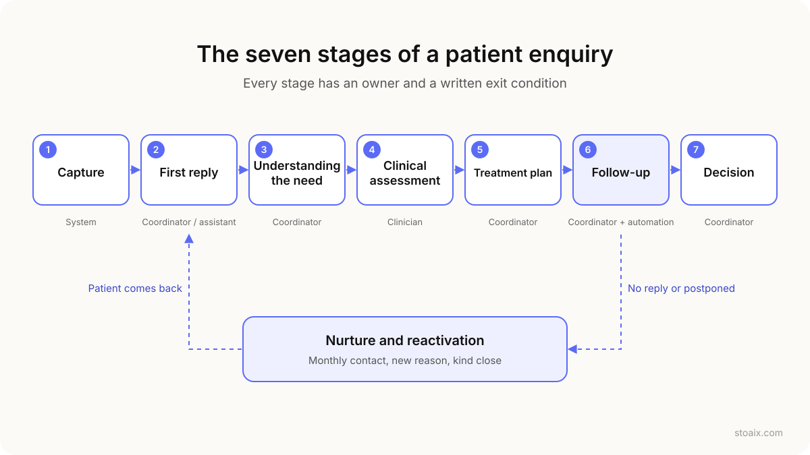

> **Short answer:** Patient enquiry management is a written, measured process in which every person who contacts your clinic is moved from first message to a booked consultation, or to a clear "no", by one named owner. It has seven stages: capture, first reply, understanding the need, clinical assessment, treatment plan, follow-up and decision. Most enquiries are not lost to advertising costs but in the gaps between these stages.

## What is patient enquiry management?

Patient enquiry management is the way a private clinic handles people who ask about treatment, from the first contact to the moment they decide. An enquiry is anyone who has messaged on WhatsApp, sent an Instagram DM, filled in a web form or rung the front desk but has not yet booked. "Management" means three concrete things: every enquiry has an owner, every stage has a written exit condition, and the time between stages is measured. Without those three, a clinic is "keeping an eye on messages", not managing enquiries. The difference shows up in practice. In an unmanaged clinic, whether an enquiry gets a fast reply depends on how busy reception happens to be that day. In a managed clinic, the same enquiry gets the same quality of reply in the same time whoever is on shift, is contacted again on set days if it goes quiet, and ends either as a booking or as a loss with a written reason.

This guide is written for private dental, aesthetic, hair restoration, ophthalmic and similar clinics in the UK. The core flow is the same for clinics treating international patients; travel and accommodation steps are added on top.

## Where do patient enquiries get lost?

Clinics usually blame lost enquiries on expensive ads or "price shoppers". When you trace the process, the losses tend to cluster at five points:

1. **Slow first reply.** Prospective patients often contact several clinics at once. In one of the most cited studies on the subject, [an analysis published in Harvard Business Review](https://hbr.org/2011/03/the-short-life-of-online-sales-leads) found that only 37% of the companies examined replied to a web enquiry within an hour and 23% never replied at all. That is general business-to-business data, not clinic data, but the mechanism is the same: interest that is not met at its peak cools quickly.
2. **No owner.** Everyone can see the message and nobody picks it up. Reception assumes the clinician will reply, the clinician assumes reception has it, and the patient waits in between.
3. **Stalling on the price question.** The first message is often "How much is it?". Either a bare figure is sent and the conversation ends, or the reply is "please book a consultation" and the question is ignored. Both send the patient back to compare other clinics.
4. **Follow-up without value.** "Just checking in, did you get a chance to look?" gives the patient nothing and asks them for something. After one or two tries, follow-up stops.
5. **No record.** Who said what, what the patient was really worried about, when they were due a call: it all lives in someone's phone. When a team member leaves or a busy week passes, the context is gone.

None of these five is fixed by a bigger marketing budget. More advertising only pushes more enquiries through the same holes.

## The seven-stage enquiry flow

The aim of the flow is not to push every enquiry to a booking as fast as possible. It is to make sure every enquiry moves to the right next step, or leaves the process with a clear decision. The table below is a starting template; adjust the timings to your capacity, but write them down.

| Stage | What happens | Exit condition | Owner | Starting point for your own standard |
|---|---|---|---|---|
| 1. Capture | Message, call or form lands in one shared list | Record created, source logged | System | Instant, no manual copying |
| 2. First reply | Patient is greeted by name, told who is writing | First question answered | Treatment coordinator or AI assistant | Minutes in opening hours, first thing next morning out of hours |
| 3. Understanding the need | Goal, concern and timing are explored | Goal noted in the patient's own words | Treatment coordinator | Same day |
| 4. Clinical assessment | Photos, X-rays or a consultation establish suitability | Clinician's view recorded | Clinician | At the time promised |
| 5. Treatment plan | Options and fees are shared in writing | Patient has received and opened the plan | Treatment coordinator | Day after assessment |
| 6. Follow-up | Contacts that add value while the patient decides | Patient decides or clearly postpones | Coordinator plus automation | Planned calendar |
| 7. Decision | Booking, deposit or a loss with a reason | Appointment in the diary or loss reason entered | Treatment coordinator | Every open enquiry has a dated task |

Each stage has its own part in this series:

- Why response time comes first and how to measure it: [speed to lead for clinics](/blog/speed-to-lead-clinics).
- Who owns the process: [the treatment coordinator role](/blog/treatment-coordinator-role-guide).
- How to write the first reply: [first reply templates for patient enquiries](/blog/first-reply-patient-enquiry-templates).
- "How much is it?": [answering patient price questions](/blog/answering-patient-price-questions).
- After the plan is sent: [treatment plan follow-up](/blog/treatment-plan-follow-up).
- "I need to think about it", "it's too expensive", "I'll ask my partner": [handling patient objections](/blog/patient-objections-handling).
- Enquiries that go silent: [unresponsive patient enquiries](/blog/unresponsive-patient-enquiries).
- Measuring all of it: [patient enquiry conversion metrics](/blog/patient-enquiry-conversion-metrics).

## Stage by stage: what matters

### 1. Capture: one list, one source field

If WhatsApp, Instagram, phone, web forms and lead ads all land in different places, the first job is to bring them into one list. A clinic CRM does this; a shared spreadsheet is a minimum. Four fields should be mandatory on every record: name, channel, source (which campaign, which page) and the first message itself. If the source field stays empty, nobody will be able to say in three months which ads actually brought patients.

### 2. First reply: speed and a human voice

The first reply has two jobs: to show you have taken the question seriously and to move the conversation to one small next step. A good first reply uses the patient's name, says who is writing, gives a short but genuine answer and ends with one easy question. A price list PDF, a long introduction to the clinic or "please book a consultation" on its own does not do that job.

### 3. Understanding the need: the patient's own words

The message may say "implant cost", but what the person really wants may be to stop covering their mouth when they laugh. Recording that sentence in their own words makes every later message personal. Three questions usually cover it: What made you look into this now? What worries you most? When are you hoping to have it done?

### 4. Clinical assessment: the promised time

The clinician owns this stage, and decisions about clinical suitability belong to the clinician alone. The coordinator's job is to gather what the clinician needs and to give the patient a clear time for the answer. If a time was promised, a message goes out at that time, even if it is only an update. In the patient's eyes, how you keep that small promise is a preview of how the clinic will behave after treatment.

### 5. Treatment plan: the document that speaks when you are not there

A treatment plan is usually read at the kitchen table, next to another clinic's quote. It should open with the patient's own goal, state clearly what is and is not included and end with one next step. Fees come after the scope is explained. Items the clinician says "may be needed" are not hidden; they are written as scenarios so nothing comes as a surprise at the consultation. Patients need this information to make an informed decision, and it reduces disputes later.

### 6. Follow-up: something of value every time

A patient who goes quiet is rarely saying no. They have either not decided yet or have simply forgotten. A follow-up message should give rather than ask: the answer to a common question, a clear note on recovery, a short summary written for a partner. If the patient says they do not want to hear more, follow-up stops and that preference is recorded.

### 7. Decision: a dated task on every open enquiry

The golden rule is simple: every open enquiry has a task with a future date. An enquiry without a task is an enquiry without an owner. A loss is a decision too, but it is recorded with a reason based on what the patient said, not a guess such as "price".

## Ad hoc follow-up versus a managed process

| Area | Ad hoc follow-up | Managed process |
|---|---|---|
| First reply | Whoever is free, whenever they are free | Written response standard, separate out-of-hours plan |
| Owner | "The team" | One named owner per enquiry |
| Price question | A bare figure or a dodge | An honest range, what it depends on and one question |
| Follow-up | One or two "just checking in" messages | A planned calendar, new information each time |
| Record | Someone's phone | CRM notes: concern, decision-maker, next step |
| Losses | Unnoticed | Reason recorded, reviewed monthly |
| Measurement | A feeling ("good month") | Stage-by-stage rates, weekly scorecard |

## Who does what: people, clinicians and software

In a small practice the process runs with two people; in a larger group it has its own team. The number of people matters less than the roles:

- **Treatment coordinator:** owns the enquiry. Understands the need, connects patient and clinician, presents the plan and runs follow-up. Does not make clinical decisions.
- **Clinician:** decides suitability and treatment options, using what the coordinator has gathered, and records a view by the promised time.
- **AI assistant:** gives the first reply at night, at weekends or during peaks, answers routine questions, writes everything to the CRM and hands over to the coordinator. Sends follow-up reminders on time.
- **CRM:** the team's shared memory. Stages, notes, tasks and loss reasons live here.

Leave information and reminders to automation and judgement and emotion to people. As soon as the patient replies, automated sequences should stop and a person should take over.

## Rules to respect in the UK

Enquiry handling is a sales conversation, but it does not sit outside healthcare and marketing rules. Three areas matter most:

- **Advertising.** Claims on your website, social media and ads fall under the [CAP Code](https://www.asa.org.uk/codes-and-rulings/advertising-codes/non-broadcast-code.html) enforced by the ASA. Avoid outcome promises, superiority claims and time-limited offers that put pressure on a medical decision. Professional regulators expect the same of their registrants in direct conversations.
- **Health data.** Photos, X-rays and medical history are special category data under UK GDPR. Keep them in the clinic's systems, not on personal phones, and tell the patient who will see them and why. The [ICO's guidance](https://ico.org.uk/for-organisations/direct-marketing-and-privacy-and-electronic-communications/) is the reference point.
- **Marketing messages.** Replying to a conversation the patient started is different from sending them marketing. Marketing by text, WhatsApp or email generally needs consent under PECR, and every message must offer an easy way to opt out.

These notes are not legal advice; check your own scripts and processes with your adviser.

## You cannot manage what you do not measure: five rates

Instead of searching for an industry average, build a baseline from your own last 90 days. Five rates are enough:

| Rate | Formula | What it tells you |
|---|---|---|
| First reply time (median) | Time from message arriving to first reply from a person or assistant | Are you losing patients at the door? |
| Conversation rate | Enquiries with at least two replies each way / all enquiries | Does your first reply start a conversation? |
| Assessment rate | Patients who send photos or attend a consultation / patients in conversation | Are you building trust early enough? |
| Plan-to-decision rate | Bookings or deposits / patients who received a plan | Are your plan and follow-up doing their job? |
| Loss reasons recorded | Losses with a recorded reason / all losses | Can you learn from what you lose? |

Use the median, not the mean: three overnight messages that waited ten hours distort the average and hide the real problem. A detailed weekly scorecard is in [patient enquiry conversion metrics](/blog/patient-enquiry-conversion-metrics).

## A 30-day setup plan

Do not try to build the process in a day. Four weeks give the team time to adapt:

| Week | What to do | What you have at the end of the week |
|---|---|---|
| Week 1: See | Connect every channel to one list. Back-fill the last 30 days of enquiries. Start measuring response time. | Your real baseline |
| Week 2: Own | Give every enquiry an owner. Write down stages and exit conditions. Set up an out-of-hours first reply. | No enquiry without an owner |
| Week 3: Standardise | Write first reply, price answer and three follow-up templates together with the team. Agree assessment turnaround times with clinicians. | The same quality whoever is writing |
| Week 4: Measure and fix | Produce the first weekly scorecard. Pick the one stage where you lose most and fix only that. | One focus for next month |

At the end of week four it is tempting to change everything at once. Don't: one bottleneck, one focus. Keep a change in place for at least three or four weeks before judging it.

## Where STOAIX fits

STOAIX was built to make this flow run inside the clinic. [Lead follow-up](/en/lead-follow-up) replies to new enquiries within seconds using the clinic's own information, records the patient's question and concern, and runs the follow-up calendar on its own. The [AI receptionist](/en/ai-receptionist) covers first replies out of hours on phone and messaging channels. Every conversation sits in the [clinic CRM](/en/clinic-crm) with a named owner and a next task. For enquiries that have been quiet for a long time, the [patient reactivation](/en/patient-reactivation) flow takes over.

What the software does not do is just as clear: it does not decide clinical suitability, does not speak for the clinician and does not send pressure messages. Every method here can be applied without software, with a spreadsheet and a disciplined coordinator; software keeps that discipline in place during busy weeks.

## Common mistakes

- **Spending more on ads first.** A leaking bucket does not fill faster with more water. Fix response time and ownership first.
- **Sending everyone the same template.** A template is a skeleton; the patient's name, question and channel should show in every message.
- **Leaving follow-up to one person's memory.** "Sarah is great at follow-up" is not a process. When Sarah is on holiday, so is the process.
- **Logging every loss as "price".** It is usually a guess. Record what the patient actually said; the real reason is often trust or timing.
- **Confusing speed with pressure.** Be fast, but do not try to make the patient fast. Fake deadlines and "today only" offers damage trust in a medical decision and can breach advertising rules.

## Frequently asked questions

### What is the difference between an enquiry and a patient?

An enquiry is someone who has contacted the clinic but has not yet booked or started treatment. They become a patient once they book and attend. The distinction matters because the purpose of talking to an enquiry is not treatment but helping them reach an informed decision.

### Do we need a dedicated treatment coordinator?

Not necessarily, but you need a dedicated role. In a small practice a receptionist can set aside fixed times of day for enquiries only. What matters is that every enquiry has one named owner and that the work is not swallowed by phone traffic. As volume grows, the coordinator role moves to a dedicated person.

### How long should we follow up a patient enquiry?

Follow up often in the first three days while the conversation is warm, less often over the next two weeks, then move to a monthly nurture rhythm. Every contact should carry something new. If the patient says they do not want further contact, stop immediately and record that preference.

### Can an AI assistant talk to patient enquiries?

Yes, within clear limits. Giving the first reply, sharing information the clinic has approved, offering appointment options and recording details are the assistant's job. Clinical assessment, personal treatment recommendations and fee negotiation stay with the team and the clinician. When the patient replies, the conversation is handed to the coordinator.

### What is the most common mistake in enquiry management?

Enquiries without an owner. Everyone sees the message and nobody takes it; the first reply is late, follow-up never happens and the patient quietly books elsewhere. Giving every enquiry an owner and a dated next task comes before every other improvement.
