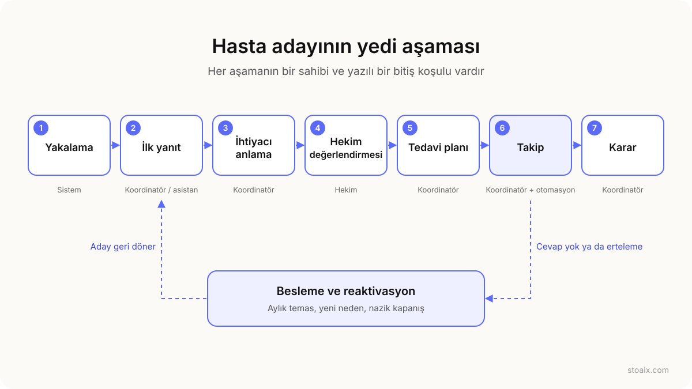

> **Kısa cevap:** Hasta adayı yönetimi, kliniğe yazan ya da arayan her kişinin ilk mesajdan randevuya (ya da açık bir "hayır"a) kadar yazılı bir süreçle, tek bir sorumlunun elinde ve ölçülerek ilerletilmesidir. Yedi aşaması vardır: yakalama, ilk yanıt, ihtiyacı anlama, hekim değerlendirmesi, teklif, takip ve karar. Kaybın çoğu reklamda değil, bu aşamaların arasındaki boşluklarda olur.

## Hasta adayı yönetimi nedir?

Hasta adayı yönetimi, bir kliniğin tedavi hakkında bilgi isteyen kişileri ilk temastan karar anına kadar planlı biçimde takip ettiği çalışma düzenidir. Hasta adayı; WhatsApp'tan fiyat soran, Instagram'dan mesaj atan, web formunu dolduran ya da telefonla arayan ama henüz randevu almamış kişidir. Yönetim kelimesi burada üç şey anlatır: her adayın bir sahibi vardır, her aşamanın yazılı bir bitiş koşulu vardır ve aşamalar arasındaki süre ölçülür. Bu üçü yoksa klinik "mesajlara bakıyor" demektir; adayları yönetmiyordur. Fark pratikte şuradadır: dağınık düzende bir aday, sekreterin o gün ne kadar yoğun olduğuna göre ya hızlı cevap alır ya hiç almaz. Yönetilen düzende aynı aday, kim nöbette olursa olsun aynı sürede aynı kalitede cevap alır, cevap vermezse belirli günlerde yeniden aranır ve sonunda ya randevuya ya da nedeni yazılmış bir kayba dönüşür.

Bu rehber diş, estetik, saç ekimi, göz ve benzeri özel kliniklerin kendi bünyesindeki süreci anlatır. Sağlık turizmi yapan klinikler için seyahat ve konaklama adımları ayrıca eklenir; temel akış aynıdır.

## Hasta adayları nerede kaybolur?

Kliniklerin çoğu kaybı reklamın pahalılığına ya da hastanın "fiyat avcısı" olmasına bağlar. Süreç incelendiğinde kayıp genellikle beş noktada toplanır:

1. **Geç ilk yanıt.** Aday aynı anda birkaç kliniğe yazar. Satış alanında en çok atıf alan çalışmalardan birinde, [Harvard Business Review'da yayımlanan analizde](https://hbr.org/2011/03/the-short-life-of-online-sales-leads) incelenen şirketlerin yalnızca %37'si web üzerinden gelen talebe bir saat içinde dönmüş, %23'ü hiç dönmemiştir. Bu çalışma klinik değil genel B2B satış verisidir; ama mekanizma aynıdır: ilgi en yüksek olduğu anda karşılanmazsa soğur.
2. **Sahipsiz aday.** Mesajı herkes görür, kimse üstlenmez. Resepsiyon "doktor dönecek" der, doktor "sekreter biliyor" der, aday arada kalır.
3. **Fiyat sorusunda tıkanma.** İlk mesaj çoğu zaman "fiyat ne kadar?" olur. Ya çıplak bir rakam yazılır ve konuşma biter ya da "muayeneye gelin" denip soru cevapsız bırakılır. İkisi de adayı başka kliniklere geri gönderir.
4. **Değersiz takip.** "Merhaba, dönüş yapabildiniz mi?" mesajı adaya hiçbir şey vermez, ondan bir şey ister. Bir iki denemeden sonra takip bırakılır.
5. **Kayıt yok.** Kim ne konuştu, adayın asıl kaygısı neydi, hangi gün aranacaktı; bunlar telefonun mesaj geçmişinde kalır. Personel değişince ya da yoğun bir haftadan sonra bütün bilgi kaybolur.

Bu beşinin ortak noktası, hiçbirinin pazarlama bütçesiyle çözülmemesidir. Daha çok reklam, daha çok adayı aynı deliklerden geçirir.

## Yedi aşamalı hasta adayı akışı

Akışın amacı her adayı hızla randevuya itmek değildir. Amaç, her adayın bir sonraki doğru adıma geçmesi ya da açık bir kararla süreçten çıkmasıdır. Aşağıdaki tablo bir klinik için başlangıç şablonudur; süreleri kendi kapasitenize göre değiştirin, ama mutlaka yazılı tutun.

| Aşama | Ne olur | Bitiş koşulu | Sahibi | Kendi standardınız için başlangıç |
|---|---|---|---|---|
| 1. Yakalama | Mesaj, arama ya da form tek bir listeye düşer | Aday kaydı açıldı, kaynağı yazıldı | Sistem | Anında, elle aktarım yok |
| 2. İlk yanıt | Adaya adıyla, kim olduğunuzu söyleyerek dönülür | Aday ilk sorusuna cevap aldı | Koordinatör ya da yapay zekâ asistanı | Mesai içinde dakikalar, mesai dışında sabah ilk iş |
| 3. İhtiyacı anlama | Adayın hedefi, kaygısı ve zamanı öğrenilir | Hedef adayın kendi cümlesiyle not edildi | Koordinatör | İlk gün içinde |
| 4. Hekim değerlendirmesi | Fotoğraf, röntgen ya da muayene ile uygunluk bakılır | Hekim görüşü yazılı | Hekim | Söz verilen saatte |
| 5. Teklif / tedavi planı | Seçenekler ve fiyat yazılı olarak paylaşılır | Aday planı aldı ve okudu | Koordinatör | Değerlendirmeden sonraki gün |
| 6. Takip | Karar sürecinde değer taşıyan temaslar | Aday karar verdi ya da açıkça erteledi | Koordinatör + otomasyon | Planlı takvim |
| 7. Karar | Randevu, kapora ya da nedeni yazılı kayıp | Randevu takvimde ya da kayıp nedeni girildi | Koordinatör | Her açık adayın tarihli bir görevi var |

Her aşamanın ayrıntısı serinin ayrı bir bölümünde anlatılıyor:

- Yanıt hızının neden ilk sırada geldiği ve nasıl ölçüleceği: [hasta adayına yanıt süresi](/blog/hasta-adayi-yanit-suresi).
- Süreci kimin sahiplendiği: [hasta koordinatörü ne iş yapar](/blog/hasta-koordinatoru-ne-is-yapar).
- İlk mesajın nasıl kurulacağı: [hasta adayına ilk mesaj örnekleri](/blog/hasta-adayina-ilk-mesaj-ornekleri).
- "Fiyat ne kadar?" sorusu: [hastanın fiyat sorusuna nasıl cevap verilir](/blog/hasta-fiyat-sorusuna-cevap).
- Teklif ya da tedavi planı gönderildikten sonrası: [tedavi planı ve teklif takibi](/blog/tedavi-plani-teklif-takibi).
- "Düşüneceğim", "pahalı", "eşime soracağım": [hasta itirazlarına cevap rehberi](/blog/hasta-itirazlari-cevap-rehberi).
- Sessizleşen adaylar: [cevap vermeyen hasta adayı](/blog/cevap-vermeyen-hasta-adayi).
- Hepsinin ölçümü: [hasta adayı dönüşüm metrikleri](/blog/hasta-adayi-donusum-metrikleri).

## Aşama aşama: neye dikkat edilir?

### 1. Yakalama: tek liste, tek kaynak alanı

WhatsApp, Instagram, telefon, web formu ve reklam formları ayrı yerlere düşüyorsa ilk iş bunları tek bir listede toplamaktır. Klinik CRM'i ya da en azından ortak bir tablo bu işi görür. Her kayıtta dört alan zorunlu olmalı: ad, kanal, kaynak (hangi reklam, hangi sayfa) ve ilk mesajın kendisi. Kaynak alanı boş kalırsa üç ay sonra hangi reklamın gerçekten hasta getirdiğini kimse söyleyemez.

### 2. İlk yanıt: hız ve insan sesi

İlk yanıtın iki işi vardır: adayın sorusunu ciddiye aldığınızı göstermek ve konuşmayı bir sonraki küçük adıma taşımak. İyi bir ilk mesaj adayın adıyla başlar, kimin yazdığını söyler, sorusuna kısa ama gerçek bir cevap verir ve tek bir kolay soruyla biter. Fiyat listesi PDF'i, uzun klinik tanıtımı ya da "muayeneye gelin" cümlesi tek başına bu işi görmez.

### 3. İhtiyacı anlama: adayın kendi cümlesi

Aday "implant fiyatı" diye yazar ama asıl istediği bazen yıllardır gülerken elini ağzına kapatmamaktır. Bu cümleyi adayın kendi kelimeleriyle kayda geçirmek, sonraki her mesajı kişisel kılar. Üç soru çoğu zaman yeter: Sizi şimdi harekete geçiren ne oldu? En çok neyden çekiniyorsunuz? Ne zaman için düşünüyorsunuz?

### 4. Hekim değerlendirmesi: söz verilen saat

Bu aşamanın sahibi hekimdir ve tıbbi uygunluk kararı yalnızca hekime aittir. Koordinatörün işi, değerlendirme için gereken bilgiyi eksiksiz toplamak ve adaya net bir dönüş saati vermektir. Dönüş saati verildiyse o saatte, sonuç hazır olmasa bile, bir ara bilgi gider. Söz verilen saatte gelen mesaj, adayın gözünde kliniğin tedavi sonrasında nasıl davranacağının provasıdır.

### 5. Teklif: sen orada değilken satan belge

Tedavi planı çoğu zaman aile masasında, başka bir kliniğin teklifinin yanında okunur. Bu yüzden plan adayın kendi hedefiyle başlamalı, neyin dahil olup neyin olmadığını açıkça yazmalı ve tek bir sonraki adımla bitmelidir. Fiyat, kapsam anlatıldıktan sonra gelir. Hekimin "gerekebilir" dediği kalemler saklanmaz; senaryo olarak yazılır ki muayenede sürpriz çıkmasın.

### 6. Takip: her temasta bir değer

Sessiz kalan aday çoğu zaman "hayır" demiyor; ya henüz karar vermemiştir ya da konuyu unutmuştur. Takip mesajı adaydan cevap istemek yerine ona bir şey vermelidir: sık sorulan bir sorunun cevabı, iyileşme sürecine dair net bir bilgi, aile için hazırlanmış kısa bir özet. Aday açıkça "istemiyorum" derse takip durur ve bu not edilir.

### 7. Karar: her açık adayın tarihli bir görevi

Sürecin altın kuralı basittir: açık her adayın gelecekte tarihi olan bir görevi vardır. Görevi olmayan aday, sahibi olmayan adaydır. Kayıp da bir karardır; ama "fiyat" diye tahminle değil, adayın kendi cümlesine dayanan bir nedenle kaydedilir.

## Örnek: bir adayın yolculuğu

Aşağıdaki örnek kurgudur ve akışın uygulamada nasıl göründüğünü anlatır.

Selin Hanım, salı akşamı saat 22.40'ta bir reklamdan kliniğin WhatsApp hattına "zirkonyum kaplama ne kadar?" diye yazar. Kayıt otomatik açılır, kaynağı reklam olarak işlenir. Kliniğin asistanı kendini asistan olarak tanıtır, fiyatın diş sayısına ve mevcut diş durumuna göre değiştiğini söyler ve "Kaç diş için düşünüyorsunuz?" diye sorar. Selin Hanım "ön dişler, düğünüm var" diye cevap verir; asistan bunu not eder ve koordinatörün sabah döneceğini yazar.

Çarşamba sabahı koordinatör Deniz kaydı devralır, düğün tarihini öğrenir ve gülümseme fotoğrafı ister. Fotoğraflar öğlen hekime gider; Deniz adaya "yarın 14.00'e kadar döneceğim" der ve o saatte hekimin görüşünü iletir. Perşembe tedavi planı gönderilir: önce Selin Hanım'ın hedefi, sonra seçenekler, kapsam ve fiyat. Aday iki gün sessiz kalır; cumartesi Deniz bir soru göndermez, düğün tarihine göre tedavi takviminin nasıl işleyeceğini anlatan kısa bir not gönderir. Pazartesi Selin Hanım muayene randevusu alır. Her adımın bir sahibi, bir saati ve bir kaydı vardır; hiçbiri tesadüfe kalmamıştır.

## Dağınık takip ile yönetilen süreç arasındaki fark

| Konu | Dağınık takip | Yönetilen süreç |
|---|---|---|
| İlk yanıt | Kim boşsa, ne zaman boşsa | Yazılı süre standardı, mesai dışı için ayrı plan |
| Sorumlu | "Ekip" | Her adayın adı belli tek bir sahibi |
| Fiyat sorusu | Çıplak rakam ya da kaçamak | Dürüst aralık, neye bağlı olduğu ve tek soru |
| Takip | Bir iki "dönüş yapabildiniz mi?" | Planlı takvim, her temasta yeni bilgi |
| Kayıt | Telefonun mesaj geçmişi | CRM'de not, kaygı, karar verici ve sonraki adım |
| Kayıp | Fark edilmez | Nedeni yazılır, ayda bir incelenir |
| Ölçüm | His ("bu ay iyi geçti") | Aşama aşama oranlar, haftalık skor kartı |

## Kim ne yapar: insan, hekim ve yazılım

Süreç küçük klinikte iki kişiyle, büyük klinikte ayrı bir ekiple yürür. Kişi sayısı değil, şapkalar önemlidir:

- **Hasta koordinatörü:** Adayın sahibidir. İhtiyacı anlar, hekim ile aday arasında köprü kurar, teklifi sunar ve takibi yürütür. Tıbbi karar vermez.
- **Hekim:** Uygunluğu ve tedavi seçeneklerini belirler. Koordinatörün aktardığı bilgiyle değerlendirme yapar ve söz verilen saatte görüşünü yazar.
- **Yapay zekâ asistanı:** Gece, hafta sonu ya da yoğun saatte ilk yanıtı verir, temel soruları yanıtlar, bilgiyi CRM'e işler ve koordinatöre devreder. Takip hatırlatmalarını zamanında gönderir.
- **CRM:** Ekibin ortak hafızasıdır. Aşamalar, notlar, görevler ve kayıp nedenleri burada durur.

Bilgi ve hatırlatma otomasyona, yargı ve duygu insana bırakılmalıdır. Aday cevap verdiği anda otomatik akış durmalı ve konuşma insana geçmelidir.

## Türkiye'de uyulması gereken kurallar

Hasta adayıyla yazışma satış konuşması olsa da sağlık hizmeti kurallarından bağımsız değildir. Üç başlık özellikle önemlidir:

- **Tanıtım kuralları.** [Sağlık Hizmetlerinde Tanıtım ve Bilgilendirme Faaliyetleri Hakkında Yönetmelik](https://www.resmigazete.gov.tr/eskiler/2025/11/20251112-2.htm) (Resmî Gazete, 12 Kasım 2025) tanıtım ve bilgilendirme faaliyetlerinde ücret, indirim, kampanya ya da promosyon bilgisine yer verilmesini yasaklar. Web sitesi, sosyal medya paylaşımı ve reklam metni tanıtımdır; adayın kendi sorusuna birebir verilen bilgi ayrı bir durumdur, ama burada da kampanya dili kullanılmamalıdır. Sonuç vaadi, "en uygun", "garantili" gibi ifadeler her kanalda risklidir.
- **Kişisel veri.** Sağlık verisi [KVKK](https://www.kvkk.gov.tr/) kapsamında özel nitelikli kişisel veridir. Fotoğraf, röntgen ve tıbbi geçmiş kişisel telefonlarda değil, kliniğin kurumsal kanallarında tutulmalı; adaya bilginin kim tarafından, ne amaçla görüleceği söylenmelidir.
- **Ticari ileti onayı.** Adayın kendi başlattığı yazışmaya cevap vermek ile ona pazarlama mesajı göndermek farklıdır. Tanıtım ve kampanya içerikli toplu mesajlar için onay gerekir ve onaylar [İleti Yönetim Sistemi](https://iys.org.tr/) üzerinden yönetilir.

Bu notlar hukuki görüş değildir; süreç metinlerinizi kendi hukuk danışmanınıza teyit ettirin.

## Ölçmeden yönetilmez: beş temel oran

Sektör ortalaması aramak yerine kendi son 90 gününüzden bir başlangıç çizgisi çıkarın. Beş oran yeter:

| Oran | Formül | Ne söyler |
|---|---|---|
| İlk yanıt süresi (ortanca) | Mesajın gelişi ile ilk insan ya da asistan cevabı arasındaki süre | Kapıda kaybediyor musunuz? |
| Konuşmaya dönüşme | En az iki karşılıklı mesaj olan aday / tüm adaylar | İlk mesajınız konuşma başlatıyor mu? |
| Değerlendirmeye geçiş | Fotoğraf, röntgen ya da muayeneye gelen / konuşan adaylar | Güveni yeterince erken kuruyor musunuz? |
| Tekliften karara | Randevu ya da kapora / teklif alan adaylar | Plan ve takip işini görüyor mu? |
| Nedeni yazılı kayıp | Nedeni girilmiş kayıp / tüm kayıplar | Kaybınızdan öğrenebiliyor musunuz? |

Ortanca kullanın, ortalama değil: gece gelen üç mesajın 10 saatlik bekleyişi ortalamayı bozar ama asıl sorunu gizler. Haftalık takip için ayrıntılı skor kartı [hasta adayı dönüşüm metrikleri](/blog/hasta-adayi-donusum-metrikleri) bölümünde.

## 30 günlük kurulum planı

Süreci bir günde kurmaya çalışmayın. Dört haftalık bir plan, ekibin yeni düzene alışmasına yeter:

| Hafta | Yapılacak | Haftanın sonunda elinizde olan |
|---|---|---|
| 1. Hafta: Gör | Bütün kanalları tek listeye bağlayın. Son 30 günün adaylarını geriye dönük girin. Yanıt süresini ölçmeye başlayın. | Gerçek başlangıç çizginiz |
| 2. Hafta: Sahiplen | Her adaya bir sahip atayın. Aşamaları ve bitiş koşullarını yazın. Mesai dışı ilk yanıt planını kurun. | Sahipsiz aday kalmaması |
| 3. Hafta: Standartlaştır | İlk mesaj, fiyat cevabı ve üç takip mesajı için şablonları ekiple birlikte yazın. Hekimle değerlendirme dönüş sürelerini anlaşın. | Kim yazarsa yazsın aynı kalite |
| 4. Hafta: Ölç ve düzelt | İlk haftalık skor kartını çıkarın. En çok kaybın olduğu tek aşamayı seçin ve yalnızca onu düzeltin. | Bir sonraki ayın tek odağı |

Dördüncü haftanın sonunda her şeyi birden değiştirmek cazip gelir. Yapmayın: tek darboğaz, tek odak. Bir değişikliğin etkisini görmek için en az üç dört hafta aynı düzende kalın.

## STOAIX bu süreçte nerede durur?

STOAIX, bu rehberdeki akışı kliniğin içinde çalışır hale getirmek için kuruldu. [Hasta adayı takibi](/hasta-adayi-takibi) hizmeti, yeni gelen adaya saniyeler içinde kliniğin kendi bilgileriyle cevap verir, adayın sorusunu ve kaygısını kaydeder ve takip takvimini kendiliğinden yürütür. [Yapay zekâ resepsiyonist](/yapay-zeka-resepsiyonist) telefon ve mesaj kanallarında mesai dışı ilk yanıtı üstlenir. Bütün konuşmalar [klinik CRM](/klinik-crm) içinde, sahibi ve sonraki görevi belli şekilde durur. Uzun süredir sessiz olan adaylar için [eski hasta canlandırma](/eski-hasta-canlandirma) akışı devreye girer.

Yazılımın yapmadığı şeyler de nettir: tıbbi uygunluk kararı vermez, hekimin yerine konuşmaz ve adaya baskı kuran mesajlar göndermez. Yöntemlerin hepsi yazılım olmadan da, bir tablo ve disiplinli bir koordinatörle uygulanabilir; yazılım bu disiplini yoğun günlerde de korur.

## Sık yapılan hatalar

- **Önce reklamı artırmak.** Delikli bir kova daha çok suyla dolmaz. Önce yanıt süresini ve sahipliği düzeltin.
- **Her adaya aynı şablonu göndermek.** Şablon bir iskelettir; adayın adı, sorusu ve kanalı her mesajda görünmelidir.
- **Takibi kişiye bırakmak.** "Ayşe Hanım çok iyi takip eder" bir süreç değildir. Ayşe Hanım izne çıktığında süreç de izne çıkar.
- **Kayıp nedenini "fiyat" diye geçmek.** Çoğu zaman tahmindir. Adayın kendi cümlesini yazın; asıl neden genellikle güven ya da zamanlamadır.
- **Baskıyı hızla karıştırmak.** Hızlı olun, adayı hızlandırmaya çalışmayın. Sahte son tarih ve "bugüne özel" mesajı sağlık kararında güveni bozar ve tanıtım kurallarına takılabilir.

## Sık sorulan sorular

### Hasta adayı ile hasta arasındaki fark nedir?

Hasta adayı, klinikle temas kurmuş ama henüz randevu almamış ya da tedaviye başlamamış kişidir. Randevu aldığı ve muayeneye geldiği anda hasta olur. Bu ayrım önemlidir çünkü hasta adayıyla iletişimin amacı tedavi değil, bilgilendirilmiş bir karara ulaşmasına yardım etmektir.

### Hasta adayı takibi için ayrı bir personel gerekir mi?

Gerekmez, ama ayrı bir şapka gerekir. Küçük klinikte resepsiyon görevlisi günün belirli saatlerini yalnızca adaylara ayırabilir. Önemli olan her adayın adı belli tek bir sahibi olması ve bu işin telefon trafiğine kurban gitmemesidir. Yoğunluk arttığında koordinatör rolü ayrı bir kişiye geçer.

### Hasta adayına ne kadar süre takip yapılmalı?

Yazışmanın sıcak olduğu ilk üç günde sık, sonraki iki haftada seyrek, ardından aylık besleme ritminde takip yapılır. Her temas yeni bir bilgi taşımalıdır. Aday açıkça istemediğini söylerse takip hemen durur ve bu tercih kaydedilir.

### Yapay zekâ asistanı hasta adayıyla konuşabilir mi?

Konuşabilir, ama sınırları belli olmalıdır. İlk yanıtı vermek, kliniğin onayladığı bilgileri paylaşmak, randevu seçenekleri sunmak ve bilgiyi kayda geçirmek asistanın işidir. Tıbbi değerlendirme, kişiye özel tedavi önerisi ve fiyat pazarlığı insan ekibe ve hekime kalır. Aday yanıt verdiğinde konuşma koordinatöre devredilir.

### Hasta adayı yönetiminde en sık yapılan hata nedir?

Adayın sahipsiz kalmasıdır. Mesaj herkese görünür ama kimse üstlenmez; sonuçta ilk yanıt gecikir, takip yapılmaz ve aday sessizce başka bir kliniğe gider. Her adaya bir sahip ve tarihli bir sonraki görev atamak, diğer bütün iyileştirmelerden önce gelir.
